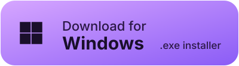
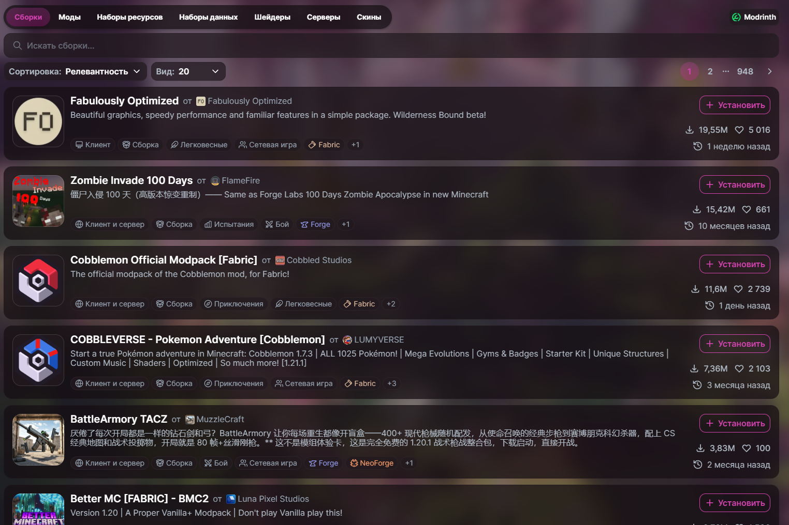
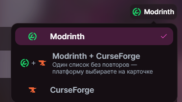
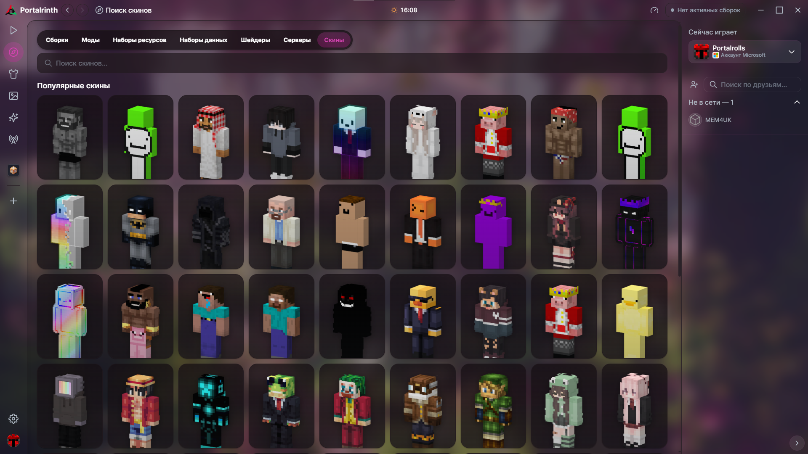
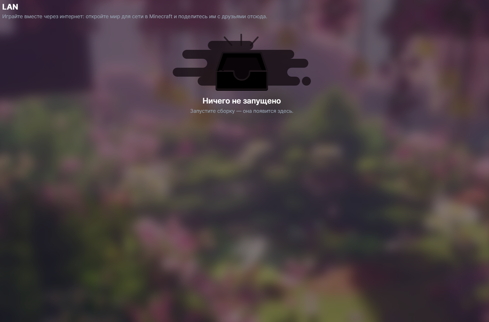
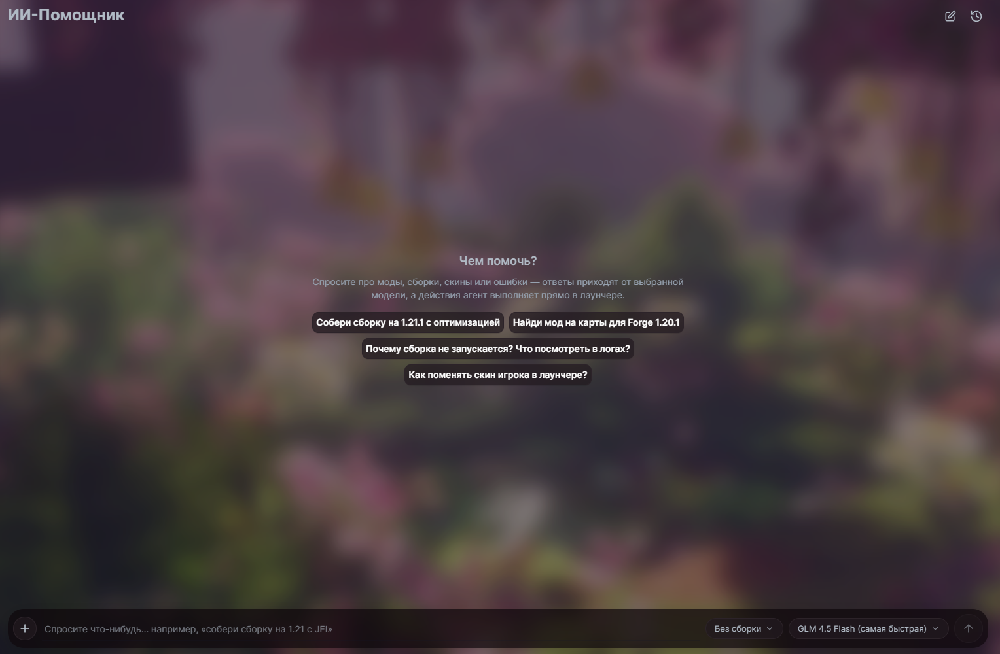
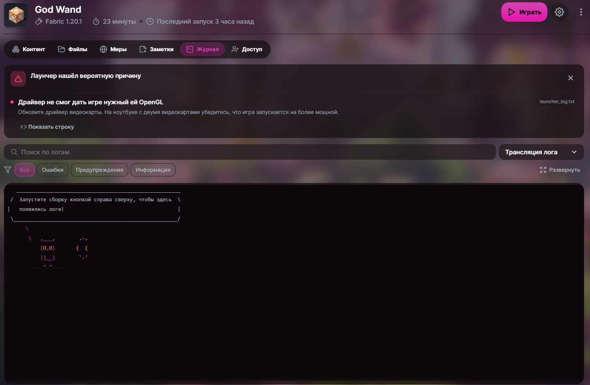
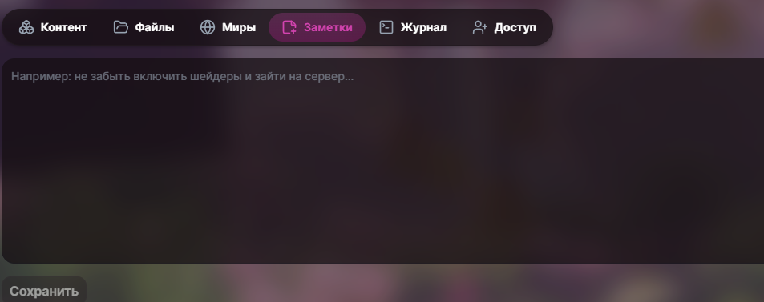
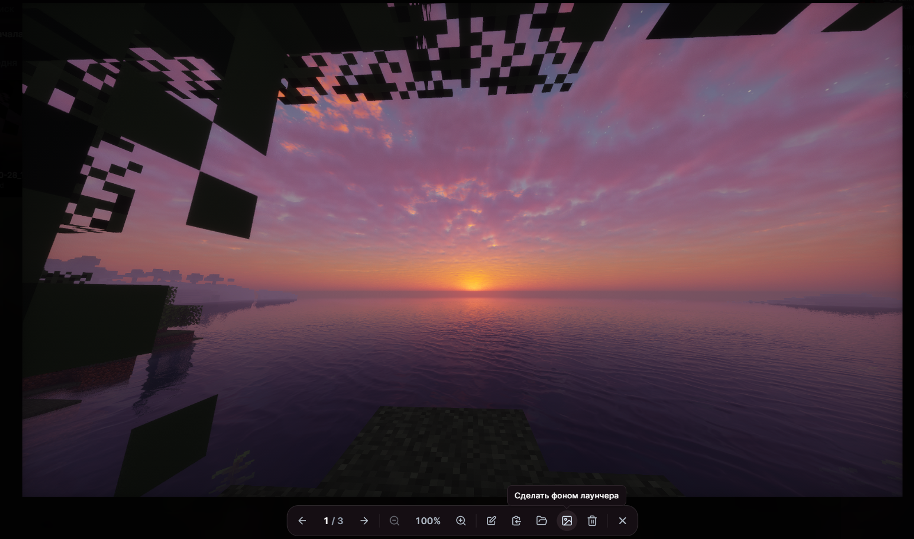

<div align="center">

[](https://github.com/manusportalgpt-beep/Portalrinth/releases)
[](https://github.com/manusportalgpt-beep/Portalrinth/releases)
[](apps/app/LICENSE)

**English** · [Русский](README.ru.md)

**A Minecraft launcher based on Modrinth App: Modrinth and CurseForge in one list, skins, LAN over the internet, an AI assistant, and Microsoft, Ely.by and offline accounts.**

<a href="https://github.com/manusportalgpt-beep/Portalrinth/releases/latest"></a>
<a href="https://github.com/manusportalgpt-beep/Portalrinth/releases/latest"></a>
<a href="https://github.com/manusportalgpt-beep/Portalrinth/releases/latest"></a>

[Releases](https://github.com/manusportalgpt-beep/Portalrinth/releases) · [Issues](https://github.com/manusportalgpt-beep/Portalrinth/issues) · [Noctrinth](https://github.com/Everelsu/Noctrinth) · [Modrinth](https://github.com/modrinth/code)

</div>

---

## About

Portalrinth is a desktop Minecraft launcher. It is built on Modrinth App and its fork Noctrinth, with Portalrinth's own features on top. The interface is in Russian and uses translucent blurred panels over a background you can replace with your own.

## Discover: Modrinth and CurseForge

<div align="center">

<br/><sub>Modpack browser: sorting, page size, pages, one-click install</sub>
</div>

- Sections: modpacks, mods, resource packs, data packs, shaders, servers and skins.
- One button switches the source: Modrinth, CurseForge, or both. In "both" mode the list is merged without duplicates, and for a project available on both platforms you choose where to install it from.
- CurseForge projects install directly into an instance; files are recognised by fingerprint and can be updated.
- Descriptions can be translated with the built-in translator (Google, or DeepL with your own key).
- When the sidebar is collapsed, filters are shown as icons, together with "Open filters", "Hide installed" and "Reset filters" buttons.

<div align="center">

<br/><sub>Platform picker</sub>
</div>

## Skins

<div align="center">

<br/><sub>Skin catalogue: search, popular skins, pages</sub>
</div>

- A catalogue of popular skins (laby.net) with search and pagination, like the other Discover sections.
- 3D preview: the model rotates, walks and crouches, the outer layer can be hidden, and capes can be tried on.
- Similar skins for the selected one, without the default Steve and Alex.
- Apply a skin to your account in one click.
- Microsoft, Ely.by and offline accounts. On offline-mode servers the launcher finds player skins by nickname on Ely.by and Mojang.

## LAN over the internet

<div align="center">

<br/><sub>LAN: a world opened to LAN in game becomes reachable for friends over the internet</sub>
</div>

- Share a world opened to LAN with friends over the internet, without port forwarding.
- See who is connected and which game mode is running.
- Ely.by account tokens are refreshed automatically.

## AI assistant

<div align="center">

<br/><sub>The AI assistant works inside the launcher</sub>
</div>

- Answers questions about mods, modpacks, skins and errors, and performs actions itself: finds and installs mods into the selected instance (compatible versions only, with dependencies), creates instances, installs modpacks, updates mods, launches the game and opens LAN.
- Sees the whole instance: Minecraft version, loader and its version, source and available updates.
- Shows Fandom and Minecraft Wiki guides as cards, writes code and builds websites with a live preview.
- Slash commands, "Web search" and "Deep thinking" modes, image input.
- Free models: GLM (default), Kilo, OVH, OpenRouter, Pollinations; DeepSeek, Kimi and others through a free NVIDIA key. If one model does not respond, the assistant falls back to the next one.
- Remembers context across chats. While it works, a progress panel is shown to the right of the clock on every page.

## Instances

<div align="center">
<table>
<tr>
<td width="50%"><br/><sub>Log: the launcher finds the likely cause of a crash</sub></td>
<td width="50%"><br/><sub>Instance notes</sub></td>
</tr>
</table>
</div>

- Instance tabs: content, files, worlds, notes, log and access.
- Log with search and level filters. The launcher detects the likely cause of a crash and points to the line that shows it.
- Per-instance notes with a reminder on launch.
- CurseForge `.zip` modpack installs: queued, resumable, with a clean rollback on failure.
- Import from Modrinth App, Prism, MultiMC, ATLauncher, GDLauncher and CurseForge.
- Clean launch without mods, and a second copy of an instance under another account.

## Screenshots

<div align="center">

<br/><sub>Screenshot viewer: zoom, edit, copy, open folder, set as launcher background, delete</sub>
</div>

- Screenshots from all instances in one place, with smooth navigation.
- Built-in editor with tools including "Fill".
- Any screenshot can become the launcher background.

## Other features

- Title bar: clock, weather, internet speed test, music player with a visualiser.
- Custom accent colour (colour wheel) and a gradient on selected tabs.
- Proxy for all launcher requests.
- No ads.
- Settings → "Changes": update check, automatic install of the newest version on start, and changelogs for Portalrinth, Noctrinth and Modrinth App with translation.

## Installation and updates

Download the installer for your system from the [latest release](https://github.com/manusportalgpt-beep/Portalrinth/releases/latest).

| System  | File                                    |
| ------- | --------------------------------------- |
| Windows | `x64-setup.exe` installer (NSIS)        |
| macOS   | `universal.dmg` (Intel and Apple Silicon) |
| Linux   | `.AppImage` or `.deb`                   |

The launcher checks GitHub releases on its own: a new version is detected by both the release tag and the release name (for example `v0.22.0+4`). With "Install updates right away" enabled, the newest version is installed when the launcher starts. Updates are never installed while the game is running.

## Building from source

Requires [Node.js](https://nodejs.org/) 24.15 or newer, [pnpm](https://pnpm.io/), [Rust](https://www.rust-lang.org/tools/install) and the [Tauri prerequisites](https://v2.tauri.app/start/prerequisites/).

```bash
pnpm install
pnpm app:dev
```

Before opening a pull request:

```bash
pnpm prepr:frontend:app
```

## Repository layout

| Path                | Contents                                                  |
| ------------------- | --------------------------------------------------------- |
| `apps/app`          | Tauri shell: Rust commands, window, updates               |
| `apps/app-frontend` | Launcher UI (Vue 3), AI assistant, translations           |
| `packages/app-lib`  | Launcher core: accounts, instances, installs, import      |
| `packages/ui`       | Shared component library                                  |

## License

The app is licensed under [GPL-3.0](apps/app/LICENSE). Other packages have their own licenses; see the `LICENSE` file in each package and [COPYING.md](COPYING.md).

Portalrinth is an independent project based on [Noctrinth](https://github.com/Everelsu/Noctrinth) and [Modrinth App](https://github.com/modrinth/code). It is not affiliated with or endorsed by Rinth, Inc.; Modrinth trademarks belong to Rinth, Inc.
