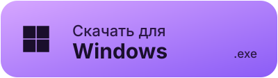

<div align="center">

[](https://github.com/manusportalgpt-beep/Portalrinth/releases)
[](https://github.com/manusportalgpt-beep/Portalrinth/releases)
[](apps/app/LICENSE)

[English](README.md) · **Русский**

**Лаунчер Minecraft на основе Modrinth App: Modrinth и CurseForge в одном списке, скины, LAN через интернет, ИИ-помощник и аккаунты Microsoft, Ely.by и оффлайн.**

<a href="https://github.com/manusportalgpt-beep/Portalrinth/releases/latest"></a>
<a href="https://github.com/manusportalgpt-beep/Portalrinth/releases/latest"></a>
<a href="https://github.com/manusportalgpt-beep/Portalrinth/releases/latest"></a>

[Релизы](https://github.com/manusportalgpt-beep/Portalrinth/releases) · [Issues](https://github.com/manusportalgpt-beep/Portalrinth/issues) · [Noctrinth](https://github.com/Everelsu/Noctrinth) · [Modrinth](https://github.com/modrinth/code)

</div>

---

## Что это

Portalrinth — настольный лаунчер Minecraft. В основе Modrinth App и его форк Noctrinth, поверх — собственные возможности Portalrinth. Интерфейс на русском, с полупрозрачными панелями с размытием поверх фона, который можно поставить свой.

## Обзор: Modrinth и CurseForge

<div align="center">

<br/><sub>Обзор сборок: сортировка, количество на странице, страницы, установка в один клик</sub>
</div>

- Разделы: сборки, моды, наборы ресурсов, наборы данных, шейдеры, серверы и скины.
- Источник выбирается одной кнопкой: Modrinth, CurseForge или оба сразу. В режиме «оба» список общий и без повторов, а на карточке проекта, который есть на обеих платформах, можно выбрать, откуда ставить.
- Проекты CurseForge ставятся прямо в сборку, файлы распознаются по отпечатку и обновляются.
- Перевод описаний встроенным переводчиком (Google, или DeepL со своим ключом).
- В свёрнутой боковой панели фильтры показываются иконками; там же кнопки «Открыть фильтры», «Скрывать установленные» и «Сбросить фильтры».

<div align="center">

<br/><sub>Выбор платформы</sub>
</div>

## Скины

<div align="center">

<br/><sub>Каталог скинов: поиск, популярные, страницы</sub>
</div>

- Каталог популярных скинов (laby.net) с поиском и страницами — как в остальных разделах Обзора.
- 3D-превью: модель поворачивается, ходит, приседает, внешний слой можно скрыть. Можно примерить плащ.
- Похожие скины к выбранному, без стандартных Стива и Алекс.
- Скин ставится на аккаунт в одно нажатие.
- Аккаунты Microsoft, Ely.by и оффлайн. На оффлайн-серверах лаунчер находит скины игроков по нику на Ely.by и в Mojang.

## LAN через интернет

<div align="center">

<br/><sub>LAN: открытый в игре мир становится доступен друзьям через интернет</sub>
</div>

- Мир, открытый в Minecraft для сети, можно отдать друзьям через интернет — без проброса портов.
- Видно, кто подключён и в каком режиме идёт игра.
- Для аккаунтов Ely.by токен обновляется сам.

## ИИ-помощник

<div align="center">

<br/><sub>ИИ-помощник работает прямо в лаунчере</sub>
</div>

- Отвечает про моды, сборки, скины и ошибки, а действия выполняет сам: ищет и ставит моды в выбранную сборку (только совместимые версии, с зависимостями), создаёт сборки, ставит модпаки, обновляет моды, запускает игру и открывает LAN.
- Видит сборку целиком: версию Minecraft, ядро и его версию, источник и обновления.
- Гайды с Fandom и Minecraft Wiki показывает карточками, умеет писать код и делать сайты с предпросмотром.
- Команды через «/», режимы «Веб-поиск» и «Глубокое мышление», работа с картинками.
- Бесплатные модели: GLM (по умолчанию), Kilo, OVH, OpenRouter, Pollinations; DeepSeek, Kimi и другие через бесплатный ключ NVIDIA. Если одна модель не отвечает, помощник переключается на следующую.
- Помнит разговоры между чатами. Пока он работает, панель с ходом работы видна справа от часов на любой странице.

## Сборки

<div align="center">
<table>
<tr>
<td width="50%"><br/><sub>Журнал: лаунчер сам находит вероятную причину сбоя</sub></td>
<td width="50%"><br/><sub>Заметки к сборке</sub></td>
</tr>
</table>
</div>

- Вкладки сборки: контент, файлы, миры, заметки, журнал и доступ.
- Журнал с поиском и фильтром по уровню. Лаунчер находит вероятную причину сбоя и показывает строку, где она видна.
- Заметки к сборке и напоминание о них при запуске.
- Установка модпаков CurseForge `.zip`: в очереди, с докачкой и чистым откатом при ошибке.
- Импорт из Modrinth App, Prism, MultiMC, ATLauncher, GDLauncher и CurseForge.
- Чистый запуск без модов и запуск второй копии сборки под другим аккаунтом.

## Скриншоты

<div align="center">

<br/><sub>Просмотр скриншотов: масштаб, редактирование, копирование, папка, фон лаунчера, удаление</sub>
</div>

- Скриншоты всех сборок в одном месте, с плавным переключением.
- Редактор с инструментами, включая «Заливку».
- Любой скриншот можно сделать фоном лаунчера.

## Остальное

- Шапка окна: часы, погода, тест скорости интернета, музыкальный плеер с визуализатором.
- Свой цвет акцента (цветовой круг) и градиент на выбранных вкладках.
- Прокси для всех запросов лаунчера.
- Без рекламы.
- Настройки → «Изменения»: проверка обновлений, автоустановка новой версии при запуске и списки изменений Portalrinth, Noctrinth и Modrinth App с переводом.

## Установка и обновления

Скачайте установщик для своей системы из [последнего релиза](https://github.com/manusportalgpt-beep/Portalrinth/releases/latest).

| Система | Файл                                |
| ------- | ----------------------------------- |
| Windows | Установщик `x64-setup.exe` (NSIS)   |
| macOS   | `universal.dmg` (Intel и Apple Silicon) |
| Linux   | `.AppImage` или `.deb`              |

Лаунчер сам проверяет релизы на GitHub: новая версия определяется по тегу и по названию релиза (например, `v0.22.0+4`). Если в настройках включено «Ставить обновления сразу», новая версия ставится при запуске лаунчера. Пока идёт игра, обновление не ставится.

## Сборка из исходников

Нужны [Node.js](https://nodejs.org/) 24.15 или новее, [pnpm](https://pnpm.io/), [Rust](https://www.rust-lang.org/tools/install) и [зависимости Tauri](https://v2.tauri.app/start/prerequisites/).

```bash
pnpm install
pnpm app:dev
```

Перед pull request:

```bash
pnpm prepr:frontend:app
```

## Структура репозитория

| Путь                | Что это                                                   |
| ------------------- | --------------------------------------------------------- |
| `apps/app`          | Оболочка Tauri: команды на Rust, окно, обновления         |
| `apps/app-frontend` | Интерфейс лаунчера (Vue 3), ИИ-помощник, переводы         |
| `packages/app-lib`  | Ядро лаунчера: аккаунты, сборки, установка, импорт        |
| `packages/ui`       | Общая библиотека компонентов                              |

## Лицензия

Приложение распространяется под [GPL-3.0](apps/app/LICENSE). У остальных пакетов свои лицензии — см. файл `LICENSE` в каждом и [COPYING.md](COPYING.md).

Portalrinth — независимый проект на основе [Noctrinth](https://github.com/Everelsu/Noctrinth) и [Modrinth App](https://github.com/modrinth/code). Он не связан с Rinth, Inc. и не одобрен ею; товарные знаки Modrinth принадлежат Rinth, Inc.
